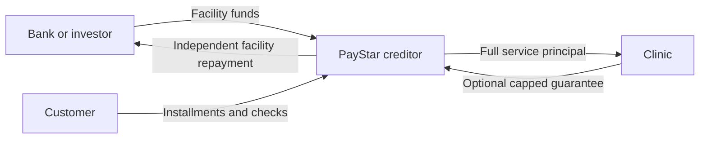
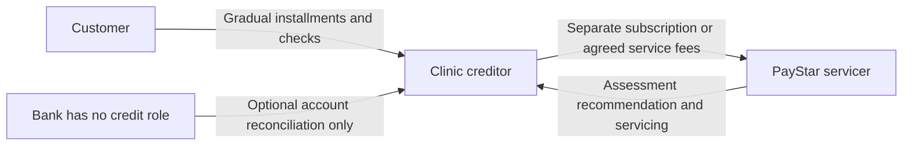
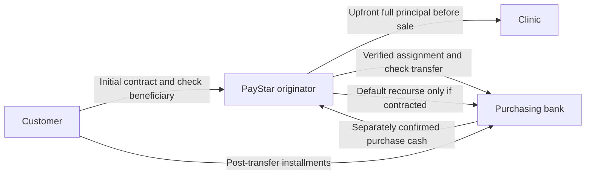

# PayStar bank collaboration — operational diagrams

Semantic implementation and meeting aids. No visual design specification or claim of live banking integration.

## Model 1 — PayStar owns customer debt

Customer default does not automatically change PayStar repayment to lender. Clinic begins service after confirmed payout.

<!-- mermaid:id=model1_funds -->

## Model 2 — Clinic owns customer debt

No PayStar or bank upfront clinic funding. Clinic bears customer default and authorizes check enforcement.

<!-- mermaid:id=model2_funds -->

## Model 3 — Originate first and sell later

Legal assignment, purchase proceeds and servicing mandate are separate. Without-recourse ordinary default remains bank risk; warranties are separate.

<!-- mermaid:id=model3_funds -->

## Model 4 — Bank is creditor from inception

No PayStar-originated receivable sale. Bank final approval and payout evidence are mandatory; bank owns legal enforcement.

```mermaid
flowchart LR
  CUSTOMER["Customer"]
  PS["PayStar facilitator"]
  BANK["Bank creditor"]
  CLINIC["Clinic"]
  PS -->|Prepared application and preliminary assessment| BANK
  BANK -->|Final decision and bank agreement| CUSTOMER
  CUSTOMER -->|Checks and installments| BANK
  BANK -->|Full service-principal disbursement| CLINIC
  PS -->|Mandated support and reminders| CUSTOMER
  CLINIC -->|Optional capped guarantee| BANK
%% portable-canonical-v2:eyJhY2Nlc3NpYmlsaXR5IjpudWxsLCJkYXRhIjp7ImRpcmVjdGlvbiI6IkxSIiwiZWRnZXMiOlt7ImZyb20iOiJQUyIsImxhYmVsIjoiUHJlcGFyZWQgYXBwbGljYXRpb24gYW5kIHByZWxpbWluYXJ5IGFzc2Vzc21lbnQiLCJ0byI6IkJBTksifSx7ImZyb20iOiJCQU5LIiwibGFiZWwiOiJGaW5hbCBkZWNpc2lvbiBhbmQgYmFuayBhZ3JlZW1lbnQiLCJ0byI6IkNVU1RPTUVSIn0seyJmcm9tIjoiQ1VTVE9NRVIiLCJsYWJlbCI6IkNoZWNrcyBhbmQgaW5zdGFsbG1lbnRzIiwidG8iOiJCQU5LIn0seyJmcm9tIjoiQkFOSyIsImxhYmVsIjoiRnVsbCBzZXJ2aWNlLXByaW5jaXBhbCBkaXNidXJzZW1lbnQiLCJ0byI6IkNMSU5JQyJ9LHsiZnJvbSI6IlBTIiwibGFiZWwiOiJNYW5kYXRlZCBzdXBwb3J0IGFuZCByZW1pbmRlcnMiLCJ0byI6IkNVU1RPTUVSIn0seyJmcm9tIjoiQ0xJTklDIiwibGFiZWwiOiJPcHRpb25hbCBjYXBwZWQgZ3VhcmFudGVlIiwidG8iOiJCQU5LIn1dLCJub2RlcyI6W3siaWQiOiJDVVNUT01FUiIsImxhYmVsIjoiQ3VzdG9tZXIifSx7ImlkIjoiUFMiLCJsYWJlbCI6IlBheVN0YXIgZmFjaWxpdGF0b3IifSx7ImlkIjoiQkFOSyIsImxhYmVsIjoiQmFuayBjcmVkaXRvciJ9LHsiaWQiOiJDTElOSUMiLCJsYWJlbCI6IkNsaW5pYyJ9XX0sImRlc2NyaXB0aW9uIjoiTm8gUGF5U3Rhci1vcmlnaW5hdGVkIHJlY2VpdmFibGUgc2FsZS4gQmFuayBmaW5hbCBhcHByb3ZhbCBhbmQgcGF5b3V0IGV2aWRlbmNlIGFyZSBtYW5kYXRvcnk7IGJhbmsgb3ducyBsZWdhbCBlbmZvcmNlbWVudC4iLCJpZCI6Im1vZGVsNF9mdW5kcyIsImtpbmQiOiJmbG93Y2hhcnQiLCJzb3VyY2VTaGEyNTYiOiI3YTBmM2RjNWYxMjJmODUzZGM1MmFkMDA1NTlmOTI4M2VkNzNlMjFmMGIzMDQ4ZmQ5ZjMyYWYyNzMzMDgyZjAzIiwic3R5bGVzIjpbXSwidGl0bGUiOiJNb2RlbCA0IOKAlCBCYW5rIGlzIGNyZWRpdG9yIGZyb20gaW5jZXB0aW9uIiwidmVyc2lvbiI6MX0
```

<!-- mermaid:id=model4_funds -->

## Model 3 — cash and legal ownership are independent

A cash delay never authorizes falsely displaying PayStar as current owner after legally effective transfer.

```mermaid
flowchart LR
  START["Seller accepts exact bank offer"]
  EVIDENCE["Verified legal assignment and check-holder acceptance"]
  CASH["Bank purchase cash confirmed"]
  ADVANCE["Cash first&#58; bank advance held by PayStar"]
  RECEIVABLE["Legal first&#58; bank owns debt&#59; PayStar has purchase-price receivable"]
  SETTLED["Both complete&#58; bank owns debt and seller has proceeds"]
  START -->|Legal evidence arrives first| EVIDENCE
  START -->|Cash arrives first| CASH
  EVIDENCE -->|Effective ownership changes| RECEIVABLE
  CASH -->|Do not change owner yet| ADVANCE
  RECEIVABLE -->|Purchase cash arrives| SETTLED
  ADVANCE -->|Legal evidence becomes effective| SETTLED
%% portable-canonical-v2:eyJhY2Nlc3NpYmlsaXR5IjpudWxsLCJkYXRhIjp7ImRpcmVjdGlvbiI6IkxSIiwiZWRnZXMiOlt7ImZyb20iOiJTVEFSVCIsImxhYmVsIjoiTGVnYWwgZXZpZGVuY2UgYXJyaXZlcyBmaXJzdCIsInRvIjoiRVZJREVOQ0UifSx7ImZyb20iOiJTVEFSVCIsImxhYmVsIjoiQ2FzaCBhcnJpdmVzIGZpcnN0IiwidG8iOiJDQVNIIn0seyJmcm9tIjoiRVZJREVOQ0UiLCJsYWJlbCI6IkVmZmVjdGl2ZSBvd25lcnNoaXAgY2hhbmdlcyIsInRvIjoiUkVDRUlWQUJMRSJ9LHsiZnJvbSI6IkNBU0giLCJsYWJlbCI6IkRvIG5vdCBjaGFuZ2Ugb3duZXIgeWV0IiwidG8iOiJBRFZBTkNFIn0seyJmcm9tIjoiUkVDRUlWQUJMRSIsImxhYmVsIjoiUHVyY2hhc2UgY2FzaCBhcnJpdmVzIiwidG8iOiJTRVRUTEVEIn0seyJmcm9tIjoiQURWQU5DRSIsImxhYmVsIjoiTGVnYWwgZXZpZGVuY2UgYmVjb21lcyBlZmZlY3RpdmUiLCJ0byI6IlNFVFRMRUQifV0sIm5vZGVzIjpbeyJpZCI6IlNUQVJUIiwibGFiZWwiOiJTZWxsZXIgYWNjZXB0cyBleGFjdCBiYW5rIG9mZmVyIn0seyJpZCI6IkVWSURFTkNFIiwibGFiZWwiOiJWZXJpZmllZCBsZWdhbCBhc3NpZ25tZW50IGFuZCBjaGVjay1ob2xkZXIgYWNjZXB0YW5jZSJ9LHsiaWQiOiJDQVNIIiwibGFiZWwiOiJCYW5rIHB1cmNoYXNlIGNhc2ggY29uZmlybWVkIn0seyJpZCI6IkFEVkFOQ0UiLCJsYWJlbCI6IkNhc2ggZmlyc3Q6IGJhbmsgYWR2YW5jZSBoZWxkIGJ5IFBheVN0YXIifSx7ImlkIjoiUkVDRUlWQUJMRSIsImxhYmVsIjoiTGVnYWwgZmlyc3Q6IGJhbmsgb3ducyBkZWJ0OyBQYXlTdGFyIGhhcyBwdXJjaGFzZS1wcmljZSByZWNlaXZhYmxlIn0seyJpZCI6IlNFVFRMRUQiLCJsYWJlbCI6IkJvdGggY29tcGxldGU6IGJhbmsgb3ducyBkZWJ0IGFuZCBzZWxsZXIgaGFzIHByb2NlZWRzIn1dfSwiZGVzY3JpcHRpb24iOiJBIGNhc2ggZGVsYXkgbmV2ZXIgYXV0aG9yaXplcyBmYWxzZWx5IGRpc3BsYXlpbmcgUGF5U3RhciBhcyBjdXJyZW50IG93bmVyIGFmdGVyIGxlZ2FsbHkgZWZmZWN0aXZlIHRyYW5zZmVyLiIsImlkIjoic2FsZV90aW1pbmciLCJraW5kIjoiZmxvd2NoYXJ0Iiwic291cmNlU2hhMjU2IjoiODFlNzM0MzFjMWVkYTg2ZTE4MWFkNzZhNzkzY2M5OTE3YzgxNjQ2M2JlNDhkNDgwZTkyZTIxYWQyOTU2ZjBhMCIsInN0eWxlcyI6W10sInRpdGxlIjoiTW9kZWwgMyDigJQgY2FzaCBhbmQgbGVnYWwgb3duZXJzaGlwIGFyZSBpbmRlcGVuZGVudCIsInZlcnNpb24iOjF9
```

<!-- mermaid:id=sale_timing -->

## Verified payment — one atomic economic effect

The browser redirect is not evidence of payment. Duplicates return the same result. Only authorized creditor account and amount can be allocated.

```mermaid
sequenceDiagram
  actor C as Customer
  participant API as PayStar API
  participant PROVIDER as Payment adapter
  participant DB as Transactional database
  participant UI as Authorized role views
  C->>API: Request payment with idempotency key
  API->>PROVIDER: Create intent for current creditor account
  PROVIDER-)API: Signed confirmation or inquiry result
  API->>DB: Lock&#59; verify unique receipt&#59; allocate&#59; post balanced journal and outbox
  DB-->>API: Commit one economic effect
  API-)UI: Authorized status event&#59; refresh persisted statement
  PROVIDER-)API: Duplicate callback
  API-->>PROVIDER: Acknowledge existing receipt&#59; no second posting
%% portable-canonical-v2:eyJhY2Nlc3NpYmlsaXR5IjpudWxsLCJkYXRhIjp7Im1lc3NhZ2VzIjpbeyJmcm9tIjoiQyIsImtpbmQiOiJzeW5jIiwidGV4dCI6IlJlcXVlc3QgcGF5bWVudCB3aXRoIGlkZW1wb3RlbmN5IGtleSIsInRvIjoiQVBJIn0seyJmcm9tIjoiQVBJIiwia2luZCI6InN5bmMiLCJ0ZXh0IjoiQ3JlYXRlIGludGVudCBmb3IgY3VycmVudCBjcmVkaXRvciBhY2NvdW50IiwidG8iOiJQUk9WSURFUiJ9LHsiZnJvbSI6IlBST1ZJREVSIiwia2luZCI6ImFzeW5jIiwidGV4dCI6IlNpZ25lZCBjb25maXJtYXRpb24gb3IgaW5xdWlyeSByZXN1bHQiLCJ0byI6IkFQSSJ9LHsiZnJvbSI6IkFQSSIsImtpbmQiOiJzeW5jIiwidGV4dCI6IkxvY2s7IHZlcmlmeSB1bmlxdWUgcmVjZWlwdDsgYWxsb2NhdGU7IHBvc3QgYmFsYW5jZWQgam91cm5hbCBhbmQgb3V0Ym94IiwidG8iOiJEQiJ9LHsiZnJvbSI6IkRCIiwia2luZCI6InJlcGx5IiwidGV4dCI6IkNvbW1pdCBvbmUgZWNvbm9taWMgZWZmZWN0IiwidG8iOiJBUEkifSx7ImZyb20iOiJBUEkiLCJraW5kIjoiYXN5bmMiLCJ0ZXh0IjoiQXV0aG9yaXplZCBzdGF0dXMgZXZlbnQ7IHJlZnJlc2ggcGVyc2lzdGVkIHN0YXRlbWVudCIsInRvIjoiVUkifSx7ImZyb20iOiJQUk9WSURFUiIsImtpbmQiOiJhc3luYyIsInRleHQiOiJEdXBsaWNhdGUgY2FsbGJhY2siLCJ0byI6IkFQSSJ9LHsiZnJvbSI6IkFQSSIsImtpbmQiOiJyZXBseSIsInRleHQiOiJBY2tub3dsZWRnZSBleGlzdGluZyByZWNlaXB0OyBubyBzZWNvbmQgcG9zdGluZyIsInRvIjoiUFJPVklERVIifV0sInBhcnRpY2lwYW50cyI6W3siYWN0b3IiOnRydWUsImlkIjoiQyIsImxhYmVsIjoiQ3VzdG9tZXIifSx7ImlkIjoiQVBJIiwibGFiZWwiOiJQYXlTdGFyIEFQSSJ9LHsiaWQiOiJQUk9WSURFUiIsImxhYmVsIjoiUGF5bWVudCBhZGFwdGVyIn0seyJpZCI6IkRCIiwibGFiZWwiOiJUcmFuc2FjdGlvbmFsIGRhdGFiYXNlIn0seyJpZCI6IlVJIiwibGFiZWwiOiJBdXRob3JpemVkIHJvbGUgdmlld3MifV19LCJkZXNjcmlwdGlvbiI6IlRoZSBicm93c2VyIHJlZGlyZWN0IGlzIG5vdCBldmlkZW5jZSBvZiBwYXltZW50LiBEdXBsaWNhdGVzIHJldHVybiB0aGUgc2FtZSByZXN1bHQuIE9ubHkgYXV0aG9yaXplZCBjcmVkaXRvciBhY2NvdW50IGFuZCBhbW91bnQgY2FuIGJlIGFsbG9jYXRlZC4iLCJpZCI6InZlcmlmaWVkX3BheW1lbnQiLCJraW5kIjoic2VxdWVuY2UiLCJzb3VyY2VTaGEyNTYiOiIwNTdmYzk2YzYxNGQwNTZhYWU4MjBlY2Y1ZGY3MWU0MDkzOGEyOGQ1OTBmMjY5MWFmNWU1MDE1MDMyMTViMWViIiwic3R5bGVzIjpbXSwidGl0bGUiOiJWZXJpZmllZCBwYXltZW50IOKAlCBvbmUgYXRvbWljIGVjb25vbWljIGVmZmVjdCIsInZlcnNpb24iOjF9
```

<!-- mermaid:id=verified_payment -->

